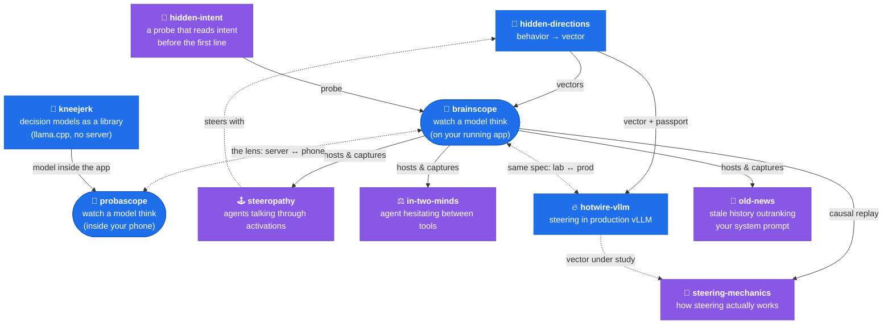

# Hey, I'm Kate 👋

**AI Engineer** • Former Particle Physicist ⚛️ • Former Risk Modeler 📈

I've spent my whole career looking inside systems that would rather stay
opaque — first particle collisions, then risk models, now neural networks.

> The models talk to us all day. **I want to be able to affect them back.**
>
> And I want to shove AI into the device and look inside it: **edge AI and interpretability**, together.

**[Why I'm really doing this → the manifesto](MANIFESTO.md)**

**Two things I do, and where to find them:**

| you want to | go to |
|---|---|
| 🔬 **see inside a model**: watch it think, find out why it did that, fix it | [the interpretability lab](#-an-open-source-interpretability-lab-tested-on-a-real-production-app) |
| 🔩 **run a model on the device**: in a phone, or on a chip that costs less than lunch | [edge AI](#-shoved-into-the-device-edge-ai) |
| 🎈 **just play with something** | [the two drawers](#-just-for-fun-two-drawers), or [the collision chamber](#-come-say-hi-in-my-collision-chamber) right below |

**Five minutes, no account, no chip:**

```
pip install brainscope && brainscope --model tiny        # watch a model think, in your browser
```
```
git clone https://github.com/moudrkat/maxwell-on-a-chip && cd maxwell-on-a-chip
cc -O2 -o host/maxwell host/maxwell.c -lm && host/maxwell 28    # Maxwell and Boltzmann at 28 °C
```

**Want to do more than look?** [Open questions I'd love help with](OPEN-QUESTIONS.md).

<br>


## 💥 Come say hi in my collision chamber

My personal site is a chat with a tiny LLM running entirely in your browser, and every answer it generates renders as a real particle collision. Click the event below to fire your own question into the chamber:

[](https://unt1l1f1nd-detektor.static.hf.space)

<br>


## 🚀 An open-source interpretability lab, tested on a real production app

> *Watch* a model think ([brainscope](https://github.com/moudrkat/brainscope), [probascope](https://github.com/moudrkat/probascope)) → *diagnose* why it did that → *fix* it at the source ([hidden-directions](https://github.com/moudrkat/hidden-directions) → [hotwire-vllm](https://github.com/moudrkat/hotwire-vllm)). Observability first; intervention last, once the instruments have earned it.

> [!TIP]
> **Don't read, just do it.** `pip install brainscope`, then `brainscope --model tiny`: a browser view of a model thinking. CPU is fine. No account, no course.

**Click any box to open its repo.**



<br>


## 🔩 Shoved into the device: edge AI

> Research that only runs behind a server isn't finished. These take it the last mile, natively. No cloud, no account, nothing phones home.

### 📱 In a phone

- 🦵 [kneejerk](https://github.com/moudrkat/kneejerk) — decision models as a library on llama.cpp: no server, one forward pass, built for a phone app.
- 📱 [probascope](https://github.com/moudrkat/probascope) — an Android app: a decision model runs in the phone, and you drag over its layers to see where the answer formed.
- 🧭 [decide-me](https://github.com/moudrkat/decide-me) — point your phone at the world and a decision model inside it tells you what to do next. I said I would not build this.

### 🔌 Inference on a chip

An ESP32-S3: 16 MB of flash, a few dollars, no operating system. Models of 3–4 million parameters, trained from scratch, running on it.

- ✏️ [esp32-ai](https://github.com/moudrkat/esp32-ai) — you type a sentence, a 3M-parameter model **inside the chip** writes a small program for its own screen, and the chip runs it. Built on [slvDev/esp32-ai](https://github.com/slvDev/esp32-ai).
- 🌡️ [maxwell-on-a-chip](https://github.com/moudrkat/maxwell-on-a-chip) — a tiny model of Maxwell and Boltzmann, sampled with their own distribution, at the temperature of the room. Maxwell's demon is on the BOOT button.

### 🤝 Where the two meet

Small models on small devices are the ones you can actually open up: [probascope](https://github.com/moudrkat/probascope) is the lens in a pocket, and [hotwire-vllm](https://github.com/moudrkat/hotwire-vllm) is the same last-mile move for steering, in production vLLM.

<br>


## 🤝 What I'm looking for

**Collaborators and users.** Build on LLMs and want to see inside your model? `pip install`, try it, and
open an issue where it breaks. Work on steering or interpretability? Run
[SteerBench](https://github.com/moudrkat/steering-mechanics/tree/main/steerbench)
against your own method and tell me what you get.

<br>


## 🎈 Just for fun: two drawers

> Smaller things, and things that got out of hand. Open either.

<details>
<summary>🔬 <b>Also on the bench</b> — smaller, self-contained ways to look inside</summary>

- 🔦 [tournament-watermarking](https://github.com/moudrkat/tournament-watermarking) — the watermark Anthropic now puts in Claude's output, running live as a decaying newspaper.
- 📜 [paper-remembers](https://github.com/moudrkat/paper-remembers) — Hopfield's 1982 paper, running live: rub out any part of the page and watch it rebuild itself.
- 🎭 [sixteen-voices](https://github.com/moudrkat/sixteen-voices) — how a tiny transformer encodes writing style.
- 👁️ [show-me-your-attention](https://github.com/moudrkat/show-me-your-attention) — attention maps and neuron activations over your own prompt.
- 💥 [detektor](https://github.com/moudrkat/detektor) — the collision chamber above, open source.
- 🖼️ [jepa-demo](https://github.com/moudrkat/jepa-demo) — I-JEPA & V-JEPA 2 hands-on, no GPU needed.
- 🍄 [Mushroom-generator](https://github.com/moudrkat/Mushroom-generator) — a VAE growing mushrooms, its decoder taken apart layer by layer.
- 🍎 [Applepear](https://github.com/moudrkat/Applepear) — apples vs pears in a tiny CNN, grad-CAM included.
- ⚙️ [Minimize_me](https://github.com/moudrkat/Minimize_me) — race TensorFlow optimizers across loss landscapes.
</details>

<details>
<summary>🃏 <b>And off the bench</b></summary>

- 🌙 [tri-kumpani](https://github.com/moudrkat/tri-kumpani) — Li Po's *Drinking Alone under the Moon*, read by a small Chinese model twelve hundred years later. [▶ open it](https://moudrkat.github.io/tri-kumpani/)
- 🚪 [resi-doom](https://github.com/moudrkat/resi-doom) — Doom, except the level is a language model mid-sentence. `W` and `S`. That is the control scheme. [▶ open it](https://unt1l1f1nd-resi-doom.static.hf.space)
- 🎸 [unlived](https://github.com/moudrkat/unlived) — a gamebook of the life you never lived. You win by quitting the game to go live it.
- 🎉 [promptparty](https://github.com/moudrkat/promptparty) — a dashboard for friends agent-coding in one room: when to 🗣️ TALK and when to ⌨️ PROMPT.
- 🎨 [personal-rembrandt](https://github.com/moudrkat/personal-rembrandt) — you can't build a personal brand, so build a personal Rembrandt: GPT-2 reads your bio and repaints his self-portrait.
- 🛏️ [go-to-damn-bed](https://github.com/moudrkat/go-to-damn-bed) — a Claude Code skill that sends you to bed. It counts to three. It never says what happens at three.
- 👑 [KingOfDiamonds](https://github.com/moudrkat/KingOfDiamonds) — the King of Diamonds game from *Alice in Borderland*, played by LLMs in character.
- 🗨️ [paralel-discordverse](https://github.com/moudrkat/paralel-discordverse) — your company's Discord gets a parallel universe of fictional colleagues.
- 🧅 [underglaze](https://github.com/moudrkat/underglaze) — the blue tile on a kitchen wall, as a sum of cosines. The pattern everyone here calls *cibulák* turns out to have no onion in it.
- 🌧️ [coalescence](https://github.com/moudrkat/coalescence) — a raindrop landing on a wet window: the thin-film equation, solved in your browser.
- 🧮 [least-squares-method](https://github.com/moudrkat/least-squares-method) — code archaeology: a printed Pascal listing, photographed page by page and revived on Turbo Pascal 5.5.
</details>

---

None of it is perfect. *That's kind of delightful.*
